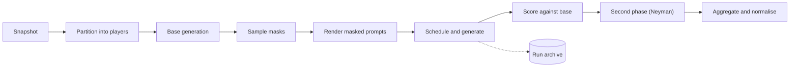

# How a run works

Part of [[nlp-shap]]. Code: [[pipeline]]. State: release 0.1.18. The user guide has a longer version for people who do not use the vault.

1. **Partition** ([[masking]]): the configured partitioner (default `tokens`) returns players with spans ([[Player span]]); plugin options are validated, the plan is checked against `max_players`, and the [[Run id]] and archive path are fixed.
2. **Base generation** ([[backends]]): the backend generates from the unmasked prompt; the text goes to the [[Run archive]] first and later serves as `v(N)` ([[Base generation]]).
3. **Sample masks** ([[estimation]]): the configured [[estimation|Estimator]] yields coalition masks within `budget.fraction` of the `2^n` table (`mc`, `complementary` and `neyman_cc` yield the grand and empty coalitions first; `exact` enumerates masks in order); the orchestrator adds them if a third-party estimator did not.
4. **Render** ([[masking]]): the [[masking|Absence policy]] rewrites the absent players' spans; jobs are rendered lazily while the scheduler consumes them, grouped by [[Prefix hash]] when the key-value (KV) cache is on.
5. **Schedule and generate** ([[runtime]]): one task group runs at most `max_inflight` backend calls; duplicate coalition keys are generated once; the first failure cancels the rest and is raised; every result is archived.
6. **Score** ([[value]]): records rebuilt from the generated text (with model embeddings when the [[value|Value function]] needs them) are scored against the base generation; the score is the coalition payoff.
7. **Second phase** ([[estimation]]): a two-phase estimator (`neyman_cc`) allocates its remaining budget from the first-phase payoffs ([[estimation|Neyman allocation]]); the new coalitions are generated and every coalition is rescored on one corpus.
8. **Aggregate and return** ([[pipeline]]): `estimate_attributions` turns payoffs into one value per player, the normaliser rescales for presentation, and `ExplainRunOutput` carries values, `base_value`, `grand_value`, scheduler metrics, run id, [[Manifest]], timings and the player set (`to_dict()` gives the JSON the command line writes).

Re-scoring without the model: [[Reanalyze]].
